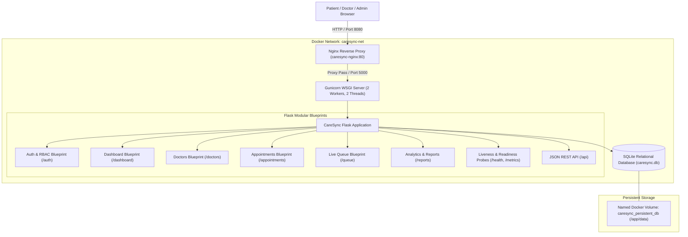
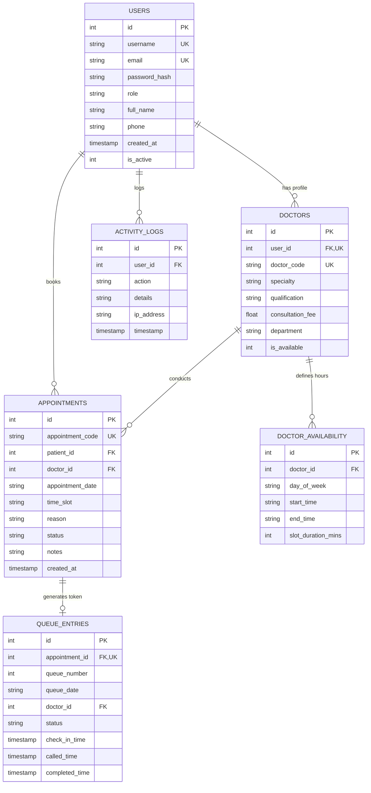
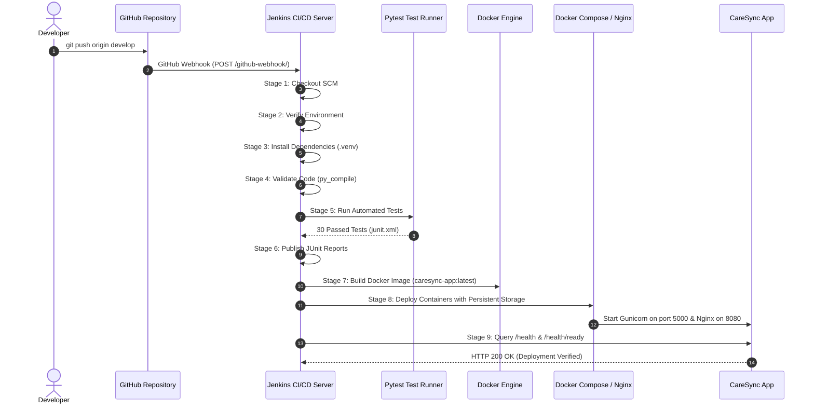

# CareSync — System Architecture & Design Specification
## 23IT723 — DevOps Laboratory Project

---

## 1. System Overview

**CareSync** is a full-stack Hospital Appointment Management System engineered with an automated CI/CD deployment pipeline. The platform addresses core clinical operational workflows:
- Patient self-registration, specialty browsing, and dynamic slot reservation.
- Real-time double-booking validation and appointment lifecycle management.
- Sequential patient queue token generation and waiting-room live status display.
- Doctor consultation scheduling and administrative clinical auditing.
- Automated testing, containerization, configuration management, and reverse proxying.

---

## 2. Architectural Diagram

---

## 3. Relational Database Schema Design

The SQLite database employs strict foreign key constraints, indexes, and transactions:

---

## 4. End-to-End DevOps Pipeline Architecture

---

## 5. Security & Authentication Architecture

1. **Password Hashing**: Passwords hashed using Werkzeug's `scrypt` algorithm with unique salt per user. Plaintext passwords are never stored.
2. **Role-Based Access Control (RBAC)**: Route decorators (`@login_required`, `@role_required`) enforce authorization before view functions execute. Patients cannot access administrative logs or other patients' appointments.
3. **Double Booking Guard**: The database and model layer enforce unique constraints on active appointments for `(doctor_id, appointment_date, time_slot)` preventing race conditions.
4. **Least-Privilege Docker Containers**: Containers run under the unprivileged `caresync` non-root system user.
